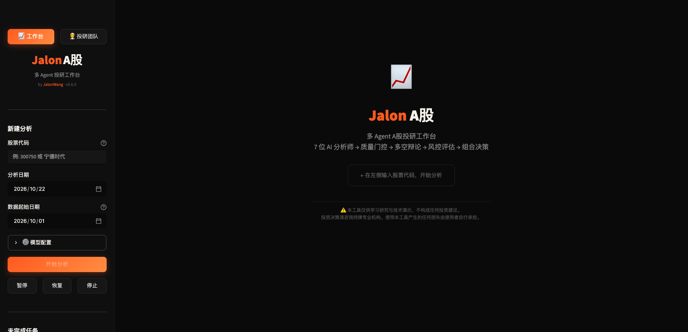

<p align="center"><b>简体中文</b> | <a href="README_en.md">English</a></p>

<h1 align="center">Jalon A股投研工作台</h1>

<p align="center">
  个人自用 · 本地部署 · 7 位 AI 分析师 · 免费 A 股数据源<br>
  自己的模型 Key，自己的提示词，自己的报告。
</p>

> **一句话**：把「7 位分析师 → 多空辩论 → 风控辩论 → 组合决策」这套多 Agent 投研流程，
> 放到你自己的电脑上跑。行情数据从公开接口直连，模型用你自己的 API Key，报告只落在本机。

> ⚠️ **仅供学习研究，不构成任何投资建议。** 本工具不提供建仓价、止损位、仓位或目标价，
> 也不代客理财。投资决策请咨询持牌专业机构，使用本工具产生的任何损失由使用者自行承担。

| 项目 | 说明 |
|------|------|
| **运行方式** | 本地 Web UI / CLI，不需要 Docker，不需要数据库 |
| **Python** | >= 3.10（推荐 3.12 / 3.13） |
| **数据** | mootdx + 腾讯 + 东财 + 新浪 + 同花顺 + 财联社 + 百度，**全部免费，无需数据 API Key** |
| **模型** | DeepSeek / MiniMax / 通义 / 智谱 / OpenAI / Claude / Gemini / xAI / Ollama / 任意 OpenAI 兼容网关 |
| **许可** | Apache-2.0（原始版权与修改声明见 [NOTICE](./NOTICE)） |

<p align="center">
  
</p>

---

## 目录

- [这个工作台是做什么的](#这个工作台是做什么的)
- [我会用它做什么](#我会用它做什么)
- [核心能力](#核心能力)
- [它是怎么跑的](#它是怎么跑的)
- [7 位分析师](#7-位分析师)
- [数据源](#数据源)
- [快速开始：从零到跑起来](#快速开始从零到跑起来)
  - [0. 先看这张准备清单](#0-先看这张准备清单)
  - [1. 检查环境](#1-检查环境)
  - [2. 没有环境怎么安装](#2-没有环境怎么安装)
  - [3. 网络慢：镜像与代理](#3-网络慢镜像与代理)
  - [4. 获取代码](#4-获取代码)
  - [5. 创建虚拟环境](#5-创建虚拟环境)
  - [6. 安装依赖](#6-安装依赖)
  - [7. 配置模型](#7-配置模型)
  - [8. 启动 Web UI](#8-启动-web-ui)
  - [9. 第一次分析怎么点](#9-第一次分析怎么点)
  - [10. 启动 CLI](#10-启动-cli)
  - [11. 停止、更新、卸载](#11-停止更新卸载)
  - [12. 常见问题排错](#12-常见问题排错)
- [项目结构](#项目结构)
- [常用配置](#常用配置)
- [投研团队与「我的战法」](#投研团队与我的战法)
- [多用户模式（给朋友用）](#多用户模式给朋友用)
- [数据与隐私](#数据与隐私)
- [许可与归属](#许可与归属)

---

## 这个工作台是做什么的

我把它定位成**一个人的盘后投研台**，不是荐股软件，也不是给团队用的 SaaS。

它把一只 A 股股票丢进一条固定的多 Agent 流水线：技术面、情绪、新闻、基本面、政策、
游资、解禁七个角度分别出报告，然后多空双方辩论，交易员给出方案，三位风控再从激进 /
保守 / 中立三个立场吵一轮，最后组合经理给出评级和理由。整个过程在本地跑，结果落成
Markdown / PDF，方便我事后回看当时到底是怎么判断的。

### 为什么是本地部署

- **数据不经过我的服务器**：这个仓库没有后端服务，行情从公开接口直接拉到你的电脑。
- **模型由你选**：DeepSeek、MiniMax、通义、智谱、OpenAI、Claude、Gemini、Ollama，
  或者你自己的中转网关。API Key 只写在你本机的 `.env` 里。
- **提示词可见、可改**：每个角色的 system / user 提示词都能在 Web 里看到并修改，
  不用改代码；改完下一次分析立即生效。
- **报告归你**：分析结果、历史记录、记忆日志都在本机 `~/.tradingagents/` 下，
  想删就删，想备份就备份。

### 它不是什么

- **不是投资顾问**：不荐股、不代客理财、不承诺收益。
- **不输出可执行价位**：代码里没有建仓价 / 止损位 / 仓位 / 目标价这些字段，
  Trader 和 Portfolio Manager 只给方向、评级和理由。
- **不是数据服务**：不提供 Tushare 积分、不代理行情、不托管任何数据。
- **不是开箱即用的 SaaS**：你需要自己装 Python、自己准备模型 Key、自己在终端启动。

---

## 我会用它做什么

- **收盘后复盘一只票**：输入 6 位代码或中文名，几分钟后拿到 7 份分析师报告、
  多空辩论、风控意见和最终评级。
- **按月 / 按自定义区间看**：把「数据起始日期」设到月初或更早，技术分析会按这个
  窗口回溯，适合做月度复盘而不是只看今天。
- **把判断过程存档**：导出 Markdown 或 PDF，和当时的行情截图放在一起；
  过一段时间回看，能清楚看到自己（和模型）在哪一步看错。
- **沉淀自己的规则**：在「我的战法」里写「RSI > 80 且 MACD 死叉 → 偏空」这类规则，
  追加到指定角色的提示词末尾，不用每次重新交代。
- **回看判断准不准**：`jalon performance` 读取记忆日志里已结算的记录，算方向正确率、
  按评级分组的 alpha，零 LLM 调用。

### 这个版本我最在意的几件事

1. **投研团队是看得见的**：16 个角色按真实执行顺序排开，运行时逐个点亮，不再是一个黑盒进度条。
2. **提示词和战法都能自己改**：每个角色的 system / user 提示词可以在浏览器里直接编辑；
   「我的战法」把反复验证过的规则单独存成策略包，按角色生效，不用改代码。
3. **跑完能复盘**：Markdown / PDF 导出、历史记录、决策绩效统计，判断和结果都留在本机。
4. **本地优先、模型自选**：不依赖我的服务器，不强制用某一家模型，Key 只放在本机 `.env`。

---

## 核心能力

| 能力 | 说明 |
|------|------|
| **7 位分析师** | 市场 / 情绪 / 新闻 / 基本面 + 政策 / 游资 / 解禁，覆盖 A 股特色因子 |
| **多空辩论** | Bull 与 Bear 各自陈述、互相反驳，研究经理综合成投资计划 |
| **三方风控** | 激进 / 保守 / 中立三位辩手 + 组合经理最终决策 |
| **中文报告** | 面向中文输出；内部辩论保留英文，减少翻译损耗 |
| **Web UI** | 侧栏输入代码即可跑，实时进度、报告展开、历史记录、Markdown/PDF 导出 |
| **投研团队页** | 16 个角色按真实执行顺序展示；可在线查看 / 编辑每个角色的提示词 |
| **我的战法** | 独立于内置提示词的个性化策略包，按角色生效，可启停、可预览合并结果 |
| **模型自由** | 10+ 供应商；支持给单个角色指定不同模型（如多空辩手用不同厂商） |
| **分角色模型** | `role_llms` 可让同一轮分析里不同角色走不同模型 |
| **断点续跑** | 可选 SQLite checkpoint；长任务中断后不必从头再来 |
| **决策绩效** | `jalon performance` 统计历史判断的方向正确率与 alpha |
| **零数据 Key** | 行情 / 财务 / 新闻全部来自免费公开接口，不需要注册数据账号 |

---

## 它是怎么跑的

```
┌─────────────────────────────────────────────────────────┐
│              7 位分析师并行取数、各自出报告                 │
│  Market → Social → News → Fundamentals                   │
│  → Policy → Hot Money → Lockup                           │
├─────────────────────────────────────────────────────────┤
│              质量门控（数据缺口检查）                       │
├─────────────────────────────────────────────────────────┤
│              Bull vs Bear 多空辩论                        │
├─────────────────────────────────────────────────────────┤
│              Research Manager 综合研判                    │
├─────────────────────────────────────────────────────────┤
│              Trader 交易方案（A 股约束）                   │
├─────────────────────────────────────────────────────────┤
│        Aggressive ←→ Conservative ←→ Neutral             │
│                三方风险辩论                               │
├─────────────────────────────────────────────────────────┤
│         Portfolio Manager 最终评级 + 理由                  │
└─────────────────────────────────────────────────────────┘
```

**双模型档位**：

- `quick_think_llm`：分析师、研究员、交易员、风控辩手，调用量大，建议用快模型。
- `deep_think_llm`：研究经理、组合经理，需要综合全局信息，建议用强模型。

> 一次完整分析通常有 30~50 次 LLM 调用。用便宜的快模型 + 1 轮辩论，成本和时间都会明显下降。

---

## 7 位分析师

### 通用四角色（A 股适配）

| 角色 | 职责 | 主要工具 |
|------|------|----------|
| 📊 市场分析师 | K 线形态、技术指标、量价关系 | `get_stock_data`, `get_indicators` |
| 💬 舆情分析师 | 社交媒体情绪、散户讨论热度 | `get_news` |
| 📰 新闻分析师 | 行业新闻、公告、宏观事件 | `get_news`, `get_global_news`, `get_insider_transactions` |
| 📋 基本面分析师 | 财报三表、盈利能力、估值 | `get_fundamentals`, `get_balance_sheet`, `get_cashflow`, `get_income_statement` |

### A 股特化三角色

| 角色 | 职责 | 为什么需要 |
|------|------|-----------|
| 🏛️ 政策分析师 | 监管政策、产业政策、窗口指导 | A 股是政策市，政策变化直接影响板块轮动 |
| 🔥 游资追踪师 | 龙虎榜、大单流向、主力资金动态 | 游资是 A 股短线定价的重要力量 |
| 🔓 解禁监控师 | 限售股解禁、大股东减持、股权质押 | 解禁是 A 股特有的供给冲击因素 |

7 份报告都会进入后续辩论和决策，不是只给一个人看。

---

## 数据源

全部免费，不需要数据 API Key，也没有积分墙：

| 来源 | 协议 | 提供内容 |
|------|------|----------|
| **mootdx** | TCP 7709 | OHLCV K 线、财务快照、F10 文本 |
| **腾讯财经** | HTTP (`qt.gtimg.cn`) | PE / PB / 市值 / 换手率（实时） |
| **东方财富** | HTTP (datacenter / push2) | 龙虎榜、限售解禁、板块行情、个股信息、资金流 |
| **新浪财经** | HTTP | K 线历史、财报三表 |
| **同花顺** | HTTP (10jqka) | EPS 一致预期、热股题材 |
| **财联社** | HTTP (cls.cn) | 全球财经快讯 |
| **百度股市通** | HTTP | 概念板块归属 |

> **关于东财限流**：东方财富的风控比较敏感，代码里所有东财请求都走统一节流入口
> `_em_get()`：默认间隔 ≥1 秒 + 随机抖动 + 复用连接。批量跑多只票时可以设
> `EM_MIN_INTERVAL=1.5~2` 进一步降速。mootdx / 腾讯 / 新浪 / 同花顺 / 财联社 / 百度
> 不受这个限流影响。

---

## 快速开始：从零到跑起来

> 下面按「完全没装过环境」的视角写。已经装好 Python 和 git 的，可以直接跳到
> [第 4 步](#4-获取代码)。

### 0. 先看这张准备清单

| 你需要 | 要求 | 说明 |
|--------|------|------|
| 电脑 | macOS 12+ / Windows 10+ / Ubuntu 20.04+ | 4GB 内存够跑，8GB 更稳 |
| Python | >= 3.10 | 推荐 3.12 或 3.13；3.9 不行 |
| git | 任意 2.x | 用来 clone 仓库；没有也能下 ZIP |
| 网络 | 能访问 GitHub 和 PyPI | 慢的话看[第 3 步](#3-网络慢镜像与代理) |
| LLM API Key | 至少一个 | DeepSeek / MiniMax / 通义 / 智谱 / OpenAI 等 |
| 磁盘 | 2GB 空闲 | 依赖 + 缓存 + 报告 |

**最快的一条路径**（已经装好 Python 和 git 的人）：

```bash
git clone https://github.com/jalonwang132-commits/TradingAgents-astock.git
cd TradingAgents-astock
python3 -m venv .venv && source .venv/bin/activate
python -m pip install -e .
cp .env.example .env        # 编辑 .env，填一个模型 Key
jalon-web
```

Windows 把 `source .venv/bin/activate` 换成 `.venv\Scripts\Activate.ps1`，
`cp` 换成 `copy`。下面每一步都有详细说明和排错。

---

### 1. 检查环境

先打开终端：

- **macOS**：`Command + 空格`，输入 `Terminal`，回车。
- **Windows**：开始菜单搜索 `PowerShell`，右键「以管理员身份运行」不是必须的，
  普通窗口即可。
- **Linux**：`Ctrl + Alt + T`。

#### 1.1 一条命令看三样

macOS / Linux：

```bash
python3 --version && python3 -m pip --version && git --version
```

Windows PowerShell：

```powershell
py --version; py -m pip --version; git --version
```

#### 1.2 怎么看结果

| 输出 | 结论 |
|------|------|
| `Python 3.12.x` / `3.13.x` | ✅ 可以直接用 |
| `Python 3.10.x` / `3.11.x` | ✅ 满足最低要求 |
| `Python 3.9.x` 或更低 | ❌ 需要装新 Python（看第 2 步） |
| `pip 24.x` 或更高 | ✅ 正常 |
| `git version 2.x` | ✅ 正常 |
| `command not found` / `不是内部或外部命令` | ❌ 对应工具没装（看第 2 步） |

> **`python`、`python3`、`py` 有什么区别？**
> macOS / Linux 通常用 `python3`；Windows 官方安装器自带 `py` 启动器。
> 如果 `python3` 指向 3.9，但你已经装了 3.12，直接用 `python3.12` 或 `py -3.12`，
> 不要跟系统自带的旧 Python 较劲。

#### 1.3 检查 pip 绑定的是哪个 Python

这一步很关键。`pip` 可能绑定在系统旧 Python 上，导致后面报
`requires a different Python: 3.9.6 not in '>=3.10'`。

```bash
python3 -m pip -V
# 末尾括号里就是它绑定的 Python，例如：
# pip 25.x from ... (python 3.12)
```

**永远用 `python -m pip` 的写法**，不要直接敲 `pip`，就不会认错解释器。

---

### 2. 没有环境怎么安装

#### 2.1 安装 Python

##### macOS

**方式 A：官方安装包（推荐给不想折腾的人）**

1. 打开 <https://www.python.org/downloads/macos/>。
2. 下载 Python 3.12 或 3.13 的 macOS 安装包（Apple Silicon 选 `arm64`，Intel 选 `x86_64`）。
3. 双击安装，一路继续。
4. 新开一个终端，验证：

```bash
python3.12 --version
```

**方式 B：Homebrew**

```bash
# 先装 Homebrew（如果还没有）
/bin/bash -c "$(curl -fsSL https://raw.githubusercontent.com/Homebrew/install/HEAD/install.sh)"

# 装 Python 3.12
brew install python@3.12

# 验证
python3.12 --version
```

如果 Homebrew 安装脚本或 bottle 下载很慢，看[第 3.4 节](#34-homebrew--apt-镜像)。

> macOS 自带的 `/usr/bin/python3` 通常是 3.9，不要用它。装完新 Python 后，
> 用 `python3.12` 或 `python3.13` 明确指定版本。

##### Windows

**方式 A：官方安装包（推荐）**

1. 打开 <https://www.python.org/downloads/windows/>。
2. 下载 Python 3.12 或 3.13 的 64-bit installer。
3. **安装第一页务必勾选 `Add python.exe to PATH`**。
4. 选 `Install Now`，等待完成。
5. 新开 PowerShell，验证：

```powershell
py --version
```

**方式 B：winget**

```powershell
winget install -e --id Python.Python.3.12
```

装完新开终端，`py -3.12 --version` 能出版本即可。

> 如果敲 `python` 弹出 Microsoft Store，说明 PATH 里没有真正的 Python。
> 用 `py` 启动器，或者重新安装并勾选 `Add python.exe to PATH`。

##### Linux（Ubuntu / Debian）

```bash
sudo apt update
sudo apt install -y python3 python3-venv python3-pip git
python3 --version
```

如果系统源里的 Python 低于 3.10（例如 Ubuntu 20.04 自带 3.8），用 deadsnakes PPA：

```bash
sudo apt update
sudo apt install -y software-properties-common
sudo add-apt-repository ppa:deadsnakes/ppa
sudo apt update
sudo apt install -y python3.12 python3.12-venv
python3.12 --version
```

CentOS / RHEL / Fedora：

```bash
sudo dnf install -y python3.12 python3.12-pip git
python3.12 --version
```

> 不想动系统 Python 的话，可以用 `conda` 或 `pyenv` 单独装一个 3.12 环境，
> 效果一样。后面所有命令把 `python3` 换成你实际用的解释器即可。

#### 2.2 安装 git

- **macOS**：终端执行 `xcode-select --install`，按提示装 Command Line Tools；
  或者 `brew install git`。
- **Windows**：到 <https://git-scm.com/download/win> 下载安装包，一路默认即可；
  或者 `winget install --id Git.Git -e`。
- **Linux**：`sudo apt install -y git`（Debian/Ubuntu）或
  `sudo dnf install -y git`（Fedora）。

验证：

```bash
git --version
```

#### 2.3 安装 uv（可选，但推荐）

`uv` 是一个更快的 Python 包管理器，能顺便帮你管理虚拟环境和 Python 版本。
不装也能用 `pip`，后面的命令两种都给了。

```bash
# 方式一：用 pip 装（走 PyPI 镜像，国内更快）
python3 -m pip install uv -i https://pypi.tuna.tsinghua.edu.cn/simple

# 方式二：官方脚本（需要能访问 astral.sh）
curl -LsSf https://astral.sh/uv/install.sh | sh
```

验证：

```bash
uv --version
```

> 如果 `uv` 装完提示 `command not found`，把 `~/.local/bin` 加进 PATH：
> `export PATH="$HOME/.local/bin:$PATH"`，然后写进 `~/.zshrc` 或 `~/.bashrc`。

---

### 3. 网络慢：镜像与代理

这一节解决三类慢：

1. `git clone` GitHub 慢 / 超时；
2. `pip install` / `uv sync` 下载 PyPI 包慢；
3. 装 Python、Homebrew 本身慢。

> 镜像站可用性会变，下面的地址如果 403 / 超时，换同类的另一个即可。
> **不要在不信任的镜像里输入账号密码或 API Key。**

#### 3.1 GitHub clone 慢

**方式 A：浅克隆（只拉最新一次提交，最快）**

```bash
git clone --depth 1 https://github.com/jalonwang132-commits/TradingAgents-astock.git
```

**方式 B：走 GitHub 镜像前缀**

```bash
# ghproxy（可用性会变，失效就换下一个）
git clone https://ghproxy.net/https://github.com/jalonwang132-commits/TradingAgents-astock.git

# gh-proxy
git clone https://gh-proxy.com/https://github.com/jalonwang132-commits/TradingAgents-astock.git

# gitclone
git clone https://gitclone.com/github.com/jalonwang132-commits/TradingAgents-astock.git
```

**方式 C：你本机有代理（Clash / V2Ray 等，端口 7890）**

```bash
git config --global http.proxy http://127.0.0.1:7890
git config --global https.proxy http://127.0.0.1:7890

# 用完想取消：
git config --global --unset http.proxy
git config --global --unset https.proxy
```

**方式 D：下载 ZIP（完全不用 git）**

浏览器打开：

```text
https://ghproxy.net/https://github.com/jalonwang132-commits/TradingAgents-astock/archive/refs/heads/main.zip
```

或者命令行：

```bash
curl -L -o jalon-astock.zip \
  https://ghproxy.net/https://github.com/jalonwang132-commits/TradingAgents-astock/archive/refs/heads/main.zip
unzip jalon-astock.zip
cd TradingAgents-astock-main
```

**方式 E：Gitee 导入**

1. 登录 <https://gitee.com>。
2. 新建仓库 → 「导入已有仓库」→ 填 GitHub 地址。
3. 等导入完成后，从 Gitee clone：

```bash
git clone https://gitee.com/<你的用户名>/TradingAgents-astock.git
```

#### 3.2 PyPI 慢：pip 镜像

常用镜像：

| 镜像 | 地址 |
|------|------|
| 清华 TUNA | `https://pypi.tuna.tsinghua.edu.cn/simple` |
| 阿里云 | `https://mirrors.aliyun.com/pypi/simple/` |
| 中科大 | `https://pypi.mirrors.ustc.edu.cn/simple/` |
| 腾讯云 | `https://mirrors.cloud.tencent.com/pypi/simple` |
| 华为云 | `https://repo.huaweicloud.com/repository/pypi/simple` |

**永久配置（推荐）**：

```bash
python3 -m pip config set global.index-url https://pypi.tuna.tsinghua.edu.cn/simple
python3 -m pip config set global.trusted-host pypi.tuna.tsinghua.edu.cn

# 查看是否生效
python3 -m pip config list
```

以后所有 `pip install` 都会走清华源。想恢复官方源：

```bash
python3 -m pip config unset global.index-url
python3 -m pip config unset global.trusted-host
```

**只对本次命令生效**：

```bash
python -m pip install -e . -i https://pypi.tuna.tsinghua.edu.cn/simple
```

**用环境变量**：

```bash
# macOS / Linux
export PIP_INDEX_URL=https://pypi.tuna.tsinghua.edu.cn/simple

# Windows PowerShell
$env:PIP_INDEX_URL="https://pypi.tuna.tsinghua.edu.cn/simple"
```

> 如果镜像报 SSL 证书错误，先升级 pip：`python -m pip install --upgrade pip -i ...`。
> 仍然不行就换一个镜像，或者加 `--trusted-host pypi.tuna.tsinghua.edu.cn`。

#### 3.3 uv 慢：uv 镜像

```bash
# macOS / Linux
export UV_DEFAULT_INDEX=https://pypi.tuna.tsinghua.edu.cn/simple
uv sync

# 或者只对本次生效
uv sync --default-index https://pypi.tuna.tsinghua.edu.cn/simple
```

Windows PowerShell：

```powershell
$env:UV_DEFAULT_INDEX="https://pypi.tuna.tsinghua.edu.cn/simple"
uv sync
```

如果 `uv` 还想自动下载 Python，而 Python 下载很慢：

```bash
# 禁止 uv 下载 Python，改用系统已装的 Python
export UV_PYTHON_DOWNLOADS=never

# 或者给 python-build-standalone 配镜像（不保证所有镜像都同步）
export UV_PYTHON_INSTALL_MIRROR=https://ghproxy.net/https://github.com/astral-sh/python-build-standalone/releases/download
```

> 最稳的做法：先用系统包管理器 / python.org 装好 Python 3.12，
> 再 `uv venv --python 3.12`，不要让 uv 去下载 Python。

#### 3.4 Homebrew / apt 镜像

**Homebrew（macOS）**：

```bash
export HOMEBREW_BREW_GIT_REMOTE="https://mirrors.tuna.tsinghua.edu.cn/git/homebrew/brew.git"
export HOMEBREW_CORE_GIT_REMOTE="https://mirrors.tuna.tsinghua.edu.cn/git/homebrew/homebrew-core.git"
export HOMEBREW_API_DOMAIN="https://mirrors.tuna.tsinghua.edu.cn/homebrew-bottles/api"
export HOMEBREW_BOTTLE_DOMAIN="https://mirrors.tuna.tsinghua.edu.cn/homebrew-bottles"

# 让当前终端生效后，再安装
brew update
brew install python@3.12
```

想长期生效，把上面四行 `export` 写进 `~/.zshrc`。

**Ubuntu apt**：

换源步骤和系统版本相关，建议直接看清华镜像的对应帮助页：
<https://mirrors.tuna.tsinghua.edu.cn/help/ubuntu/>。不要照抄过时的
`sources.list`，Ubuntu 24.04 用的是 `/etc/apt/sources.list.d/ubuntu.sources`。

---

### 4. 获取代码

#### 4.1 用 git clone

```bash
git clone https://github.com/jalonwang132-commits/TradingAgents-astock.git
cd TradingAgents-astock
```

慢的话回到[第 3.1 节](#31-github-clone-慢)换镜像或下 ZIP。

#### 4.2 确认目录对了

```bash
pwd
ls
```

应该能看到：

```text
pyproject.toml  README.md  tradingagents/  web/  cli/  .env.example
```

如果 `cd` 进去发现是空的，或者只有一层同名目录，说明解压路径多套了一层，
再 `cd` 进真正的项目根目录。

---

### 5. 创建虚拟环境

**为什么要虚拟环境**：项目的依赖（pandas、streamlit、langchain 等）版本比较具体，
装进系统 Python 容易和别的项目打架。虚拟环境就是一个独立的文件夹，删掉即卸载。

#### 5.1 macOS / Linux

```bash
# 用你实际装的版本，3.12 或 3.13
python3.12 -m venv .venv

# 激活
source .venv/bin/activate

# 确认当前 python 指向 .venv
which python
python -V
```

激活后终端提示符前面通常会出现 `(.venv)`。

#### 5.2 Windows PowerShell

```powershell
py -3.12 -m venv .venv
.\.venv\Scripts\Activate.ps1
python -V
```

Windows CMD：

```bat
py -3.12 -m venv .venv
.venv\Scripts\activate.bat
```

如果 PowerShell 报「禁止运行脚本」：

```powershell
Set-ExecutionPolicy -Scope CurrentUser RemoteSigned
```

然后重新执行激活命令。

#### 5.3 用 conda 也行

```bash
conda create -n jalon python=3.12 -y
conda activate jalon
python -V
```

#### 5.4 常见问题

- `No module named venv` / `ensurepip is not available`：
  Ubuntu 上装 `sudo apt install -y python3.12-venv`。
- `python3.12: command not found`：Python 没装好，或者版本号写错，
  回到[第 2.1 节](#21-安装-python)。
- 激活后 `python -V` 还是旧版本：确认 `which python` 指向 `.venv/bin/python`。

---

### 6. 安装依赖

> 先确认已经激活虚拟环境（提示符有 `(.venv)`），并且当前目录是项目根目录。

#### 方式 A：pip（最通用）

```bash
# 1) 升级 pip（走镜像）
python -m pip install --upgrade pip -i https://pypi.tuna.tsinghua.edu.cn/simple

# 2) 安装项目本身（-e 表示可编辑安装，改代码立即生效）
python -m pip install -e . -i https://pypi.tuna.tsinghua.edu.cn/simple
```

如果你的 pip 已经永久配了镜像，可以省略 `-i ...`。

#### 方式 B：uv（更快）

```bash
# 创建虚拟环境（如果第 5 步已经创建过，可跳过）
uv venv --python 3.12
source .venv/bin/activate

# 按 uv.lock 安装，保证版本和作者测试时一致
UV_DEFAULT_INDEX=https://pypi.tuna.tsinghua.edu.cn/simple uv sync
```

Windows：

```powershell
uv venv --python 3.12
.\.venv\Scripts\Activate.ps1
$env:UV_DEFAULT_INDEX="https://pypi.tuna.tsinghua.edu.cn/simple"
uv sync
```

#### 可选：Claude 订阅额度

如果你想让部分节点走自己的 Claude Pro/Max 订阅额度（而不是按 token 计费），
再装可选依赖：

```bash
python -m pip install -e ".[agentsdk]" -i https://pypi.tuna.tsinghua.edu.cn/simple

# 或
uv sync --extra agentsdk
```

> 不装不影响主流程。它只是给 `claude_agent_sdk` 这个 provider 用的。

#### 6.1 验证安装

```bash
python -c "import streamlit, tradingagents; print('deps ok')"
jalon --help
```

`jalon --help` 能打印命令列表，说明入口脚本也装好了。

如果 `jalon: command not found`：

- 确认虚拟环境已激活；
- 重新执行 `python -m pip install -e .`；
- 或者直接用 `python -m cli.main --help`。

#### 6.2 安装很慢 / 卡在某个包

1. 确认 pip 用的是镜像：`python -m pip config list`。
2. 单独装卡住的包，看真实报错：
   ```bash
   python -m pip install -v "包名" -i https://pypi.tuna.tsinghua.edu.cn/simple
   ```
3. 清理缓存再试：
   ```bash
   python -m pip cache purge
   ```
4. 如果是 `mootdx` / `httpx` 相关冲突，本项目已经把版本钉在可用区间，
   不要手动升级 `httpx` 到 0.28+，否则会破坏 mootdx。

---

### 7. 配置模型

#### 7.1 复制配置文件

macOS / Linux：

```bash
cp .env.example .env
```

Windows：

```powershell
copy .env.example .env
```

#### 7.2 填一个模型 Key

用编辑器打开 `.env`：

```bash
nano .env
# 或者
code .env
```

Windows 可以用 `notepad .env`。

**只填你用的一家即可**，不要把所有 Key 都填上。常用配置：

| 供应商 | Web UI 里选 | `.env` 变量 | 模型示例 |
|--------|-------------|-------------|----------|
| DeepSeek | DeepSeek | `DEEPSEEK_API_KEY` | `deepseek-v4-flash` / `deepseek-v4-pro` |
| MiniMax | MiniMax | `MINIMAX_API_KEY` | `MiniMax-M2.7-highspeed` / `MiniMax-M2.7` |
| 通义千问 | Qwen | `DASHSCOPE_API_KEY` | `qwen3.5-flash` / `qwen3.6-plus` |
| 智谱 GLM | GLM | `ZHIPU_API_KEY` | `glm-5.3-flash` / `glm-5.3` |
| OpenAI | OpenAI | `OPENAI_API_KEY` | `gpt-5.4-mini` / `gpt-5.4` |
| Anthropic | Anthropic | `ANTHROPIC_API_KEY` | `claude-sonnet-4-6` / `claude-opus-4-6` |
| Gemini | Google | `GOOGLE_API_KEY` | 需额外安装，见排错 |
| xAI | xAI | `XAI_API_KEY` | `grok-4-1-fast-non-reasoning` |
| Ollama | Ollama | 不需要 Key | 本机模型名 |
| 任意 OpenAI 兼容网关 | OpenAI 兼容（自定义 base_url） | `OPENAI_COMPATIBLE_API_KEY` + `BACKEND_URL` | 网关支持的模型 ID |

**最小示例（DeepSeek）**：

```dotenv
DEEPSEEK_API_KEY=sk-你的key
```

**最小示例（MiniMax）**：

```dotenv
MINIMAX_API_KEY=你的key
```

**OpenAI 兼容中转**：

```dotenv
OPENAI_COMPATIBLE_API_KEY=你的key
BACKEND_URL=https://your-relay.example/v1
```

然后在 Web 侧栏选「OpenAI 兼容（自定义 base_url）」，填模型 ID 和 Base URL。

**Kimi 走 Anthropic 兼容接口**：

```dotenv
ANTHROPIC_API_KEY=你的kimi-token
ANTHROPIC_BASE_URL=https://api.kimi.com/coding/
```

> 两个都要设。只给 key 不给端点，请求会发到 Anthropic 官方并报 401。

#### 7.3 几个注意点

- `.env` 已经在 `.gitignore` 里，**不要提交到 Git**。
- 改完 `.env` 要**重启** Web / CLI 才生效（`load_dotenv` 只在进程启动时读一次）。
- 一个 Key 对应一个供应商，不要拿 DeepSeek 的 Key 填到 `OPENAI_API_KEY`。
- 没有 API Key 也能启动界面，但点「开始分析」会报认证错误；数据源不需要 Key。

---

### 8. 启动 Web UI

确认虚拟环境已激活，在项目根目录执行：

```bash
jalon-web
```

等价命令：

```bash
tradingagents-web
# 或者
python -m streamlit run web/app.py
```

终端会输出类似：

```text
Local URL: http://localhost:8501
Network URL: http://192.168.x.x:8501
```

浏览器打开 <http://localhost:8501>。

> **首次启动会要求创建一个 owner 账户**（用户名 + 密码，至少 8 位）。owner 继续
> 使用旧的 `~/.tradingagents/` 目录，CLI 与 Web 看到同一份历史。之后朋友要注册，
> 必须由 owner 在「👤 账户 → 管理 → 邀请码」里生成邀请码。
> 多用户部署、公网 TLS、备份与权限边界见 [MULTIUSER.md](./MULTIUSER.md)。
>
> 首次启动如果 Streamlit 问邮箱，直接回车跳过即可。
> 终端不要关，关了服务就停了。

#### 8.1 端口被占用

```bash
python -m streamlit run web/app.py --server.port 8502
```

然后访问 <http://localhost:8502>。

#### 8.2 浏览器没自动打开

手动访问 <http://127.0.0.1:8501>。如果还是打不开：

- 确认终端没有报错、进程还在；
- 确认端口没被防火墙拦；
- 换 `127.0.0.1` 而不是 `localhost` 试试。

#### 8.3 停止服务

在运行终端按 `Ctrl + C`。

---

### 9. 第一次分析怎么点

打开 Web 后，左侧是工作台，右侧是主区域。

1. **选模型并保存自己的 API Key**：点「⚙️ 模型配置」，选供应商、快速模型、
   深度模型，然后在同面板的「API Key」里粘贴并保存（或到「👤 账户 → API Key」）。
   第一次建议用 DeepSeek 或 MiniMax 的快模型，便宜、够用。
   普通成员不会借用服务器 `.env` 里 owner 的 Key；没配 Key 会被「开始分析」拦住。
2. **填股票**：输入 6 位代码（如 `600519`）或中文名（如 `贵州茅台`）。
3. **选分析日期**：默认今天；也可以选历史日期做复盘。
4. **选数据起始日期**：默认本月第一天。想做月度复盘，就设到月初；
   想看更长周期，就往前调。
5. **点「开始分析」**。
6. 右侧会显示实时进度：7 位分析师 → 质量门控 → 多空辩论 → 交易员 →
   三方风控 → 组合决策。
7. 跑完后可以展开每一份报告，底部有「下载 Markdown」「下载 PDF」。
8. 历史记录在左侧，点一下可以回看之前的分析。

**跑一轮要多久？**

取决于模型和辩论轮数。默认 1 轮辩论、7 位分析师，大约 30~50 次 LLM 调用。
快模型通常几分钟；推理模型可能十几分钟。**不要中途关终端**。

**想更快 / 更便宜**：

- 减少参与的分析师（投研团队页可以关掉部分角色）；
- 辩论轮数设为 1；
- 快速模型用便宜的 flash / highspeed 档；
- 深度模型只在研究经理和组合经理上用强模型。

---

### 10. 启动 CLI

```bash
jalon                 # 交互式分析
jalon analyze         # 同上（默认命令）
jalon performance     # 决策绩效统计（零 LLM 调用）
jalon --help          # 查看所有选项
```

兼容入口：

```bash
tradingagents
tradingagents performance
```

也可以直接跑一个最小脚本：

```bash
python main.py
```

`main.py` 默认是 MiniMax 示例；用 DeepSeek 的话，把里面 `config` 换成注释里的
DeepSeek 配置，并确认 `.env` 里有对应 Key。

---

### 11. 停止、更新、卸载

#### 停止

- Web：终端 `Ctrl + C`。
- CLI：按提示退出，或 `Ctrl + C`。

#### 更新代码

```bash
git pull
python -m pip install -e .    # 依赖有变化时重跑
```

用 uv 的话：

```bash
git pull
uv sync
```

#### 卸载

```bash
deactivate                    # 退出虚拟环境
rm -rf .venv                  # 删除虚拟环境（项目依赖就没了）
```

用户数据在 `~/.tradingagents/`，想彻底清掉再：

```bash
rm -rf ~/.tradingagents
```

> 删除前确认里面没有你想保留的历史报告和记忆日志。

---

### 12. 常见问题排错

#### Q1：`python3 --version` 是 3.9，装不上

说明你用的是系统自带 Python。装 3.12 后用 `python3.12` 建虚拟环境：

```bash
python3.12 -m venv .venv
source .venv/bin/activate
```

#### Q2：`pip install -e .` 报 `requires a different Python: 3.9.6 not in '>=3.10'`

`pip` 绑定到了旧 Python。用 `python3.12 -m pip`，不要直接敲 `pip`：

```bash
python3.12 -m pip install -e .
```

#### Q3：`git clone` 卡住 / `early EOF` / `RPC failed`

换浅克隆或镜像：

```bash
git clone --depth 1 https://github.com/jalonwang132-commits/TradingAgents-astock.git
# 或
git clone https://ghproxy.net/https://github.com/jalonwang132-commits/TradingAgents-astock.git
```

还不行就下 ZIP，见[第 3.1 节](#31-github-clone-慢)。

#### Q4：`pip install` 很慢，一直转圈

配置镜像：

```bash
python -m pip config set global.index-url https://pypi.tuna.tsinghua.edu.cn/simple
python -m pip config set global.trusted-host pypi.tuna.tsinghua.edu.cn
```

然后重试。确认生效：`python -m pip config list`。

#### Q5：`jalon: command not found`

- 虚拟环境没激活：`source .venv/bin/activate`；
- 没装项目：`python -m pip install -e .`；
- 直接用模块方式：`python -m cli.main --help`。

#### Q6：`Address already in use` / 8501 被占用

```bash
python -m streamlit run web/app.py --server.port 8502
```

#### Q7：启动报 `ModuleNotFoundError: No module named 'tradingagents'`

在错误的目录启动了。`cd` 到项目根目录（有 `pyproject.toml` 的那一层），
或者重新 `python -m pip install -e .`。

#### Q8：点「开始分析」报没有 API Key

`.env` 里没填对应供应商的变量，或者填错了名字。对照[第 7.2 节](#72-填一个模型-key)
检查，改完**重启** Web。

#### Q9：报告写到一半就断了

撞到输出 token 上限，不是上下文超长。调大：

```dotenv
TRADINGAGENTS_MAX_TOKENS=16000
```

或者在 config 里设 `"max_tokens": 16000`。

#### Q10：部分分析师报告是空的

通常是模型 tool-call 能力弱，没成功调用数据工具。换 tool-call 更稳的模型
（DeepSeek / 通义 / GLM / Claude / GPT），或者重试。空报告会被自动跳过，
不会显示成空白卡片。

#### Q11：PDF 导出报中文字体错误

系统缺中文字体。macOS 一般自带；Linux 装：

```bash
sudo apt install -y fonts-noto-cjk
```

或者直接用「下载 Markdown」，零字体依赖。也可以指定字体：

```bash
export TRADINGAGENTS_PDF_FONT=/path/to/your/font.ttf
```

#### Q12：东方财富接口返回空 / 被限流

东财风控比较严。批量分析时放慢：

```bash
export EM_MIN_INTERVAL=2
```

只影响东财，不影响 mootdx / 腾讯 / 新浪。

#### Q13：mootdx 连不上

mootdx 走 TCP 7709，部分公司网络 / 防火墙会拦。换网络、关代理，或者等一会儿再试。
其它数据源（腾讯 / 新浪 / 东财）不依赖 mootdx，部分报告仍可生成。

#### Q14：Windows 激活虚拟环境报「禁止运行脚本」

```powershell
Set-ExecutionPolicy -Scope CurrentUser RemoteSigned
```

然后重新 `.\.venv\Scripts\Activate.ps1`。

#### Q15：装 Gemini 报 httpx 冲突

`mootdx` 需要 `httpx<0.26`，而新版 `langchain-google-genai` 需要 `httpx>=0.28.1`，
二者结构性冲突。本项目默认不装 Gemini。确实要用，单独装：

```bash
python -m pip install --no-deps "langchain-google-genai>=4.0.0"
python -m pip install "google-genai>=1.53.0" "httpx>=0.28.1"
```

> mootdx 取行情走通达信 TCP 协议，运行时并不 import httpx，所以把 httpx 抬高到
> 0.28+ 实测不影响取数；但这毕竟绕过了依赖约束，升级前建议先备份虚拟环境。

更省心的做法是用 DeepSeek / MiniMax / 通义 / GLM / OpenAI 兼容网关。

#### Q16：想换端口 / 局域网访问

```bash
python -m streamlit run web/app.py --server.port 8502 --server.address 0.0.0.0
```

> 局域网访问会把登录页暴露给同网段设备。v0.7.0 起有账户登录，但仍建议只在你
> 信任的网络开启；公网部署请按 [MULTIUSER.md](./MULTIUSER.md) 加 TLS 反向代理。

---

## 项目结构

```text
TradingAgents-astock/
├── tradingagents/              # 核心框架
│   ├── agents/                 # 7 位分析师、研究员、风控、经理
│   │   ├── analysts/
│   │   ├── researchers/
│   │   ├── risk_mgmt/
│   │   ├── managers/
│   │   └── trader/
│   ├── dataflows/
│   │   ├── a_stock.py          # A 股数据 vendor（直连 HTTP）
│   │   ├── interface.py        # 数据接口抽象
│   │   └── ...
│   └── graph/
│       ├── trading_graph.py    # 主入口 TradingAgentsGraph
│       ├── setup.py            # LangGraph 拓扑
│       ├── propagation.py
│       └── reflection.py
├── web/                        # Streamlit Web UI
│   ├── app.py                  # 主入口（认证门 → 业务页）
│   ├── branding.py             # 品牌常量（名字/作者/仓库/版本）
│   ├── user_paths.py           # 每用户目录布局（owner 复用旧根目录）
│   ├── user_context.py         # 线程级用户上下文（ContextVar）
│   ├── secrets_store.py        # 每用户 API Key（0600）
│   ├── run_registry.py         # 并发租约 / 每日次数 / 磁盘配额
│   ├── auth/                   # 账户、密码、邀请码、限流、审计、登录门
│   ├── runner.py               # 后台线程运行分析（绑定用户目录 + 释放租约）
│   ├── progress.py             # 进度追踪
│   ├── history.py              # 历史记录（当前账户）
│   ├── pdf_export.py           # PDF / Markdown 导出
│   ├── launch.py               # jalon-web 启动器
│   └── components/
│       ├── sidebar.py          # 侧栏（模型 / API Key / 账户入口）
│       ├── account_view.py     # 我的账户 + owner 管理
│       ├── progress_panel.py   # 进度面板
│       ├── report_viewer.py    # 报告展示
│       └── team_view.py        # 投研团队页
├── cli/                        # 命令行入口
│   ├── main.py
│   ├── announcements.py
│   └── static/welcome.txt
├── main.py                     # 最小可运行示例
├── pyproject.toml
├── NOTICE                      # Apache-2.0 归属声明
└── LICENSE
```

---

## 常用配置

所有配置通过传给 `TradingAgentsGraph(config=...)` 的字典覆盖，只写要改的键，
其余用 `tradingagents/default_config.py` 的默认值。

| 参数 | 默认值 | 说明 |
|------|--------|------|
| `llm_provider` | `"openai"` | `deepseek` / `minimax` / `qwen` / `glm` / `openai` / `anthropic` / `google` / `xai` / `ollama` / `openai_compatible` |
| `deep_think_llm` | `"gpt-5.4"` | 研究经理 + 组合经理用的强模型 |
| `quick_think_llm` | `"gpt-5.4-mini"` | 分析师 / 交易员 / 风控用的快模型 |
| `backend_url` | `None` | 自定义 API 端点 / 中转网关；也可用 `.env` 的 `BACKEND_URL` |
| `max_tokens` | `None` | 单次回复最大输出 token；报告截断时调大 |
| `output_language` | `"Chinese"` | 报告输出语言 |
| `market_lookback_days` | `None` | 技术分析回溯天数，Web 由「数据起始日期」自动算 |
| `max_debate_rounds` | `1` | 多空辩论轮数（1~5） |
| `max_risk_discuss_rounds` | `1` | 风险辩论轮数（1~5） |
| `role_llms` | `{}` | 给单个角色指定不同 provider / model |
| `selected_analysts` | 全部 7 位 | 本次参与的分析师 |
| `agent_prompts` | `{}` | 按角色覆盖提示词 |
| `strategy_packs` | `[]` | 「我的战法」策略包 |
| `checkpoint_enabled` | `False` | 启用 SQLite 断点续跑 |
| `llm_timeout` | `150` | 单次 LLM 请求超时（秒） |
| `llm_max_retries` | `3` | 应用层重试次数（OpenAI 兼容 provider） |
| `EM_MIN_INTERVAL` | `1.0` | 东财请求最小间隔（环境变量，批量时调大） |

更完整的配置说明见 `tradingagents/default_config.py`。

> 上表是库 / CLI 的默认值。**Web 侧栏首次默认选 MiniMax**，可以在「⚙️ 模型配置」里
> 改成 DeepSeek、通义等；改完会记到 `~/.tradingagents/llm_config.json`，下次自动恢复。

---

## 投研团队与「我的战法」

侧栏切到「🧑‍💼 投研团队」可以：

- **看完整团队**：7 位分析师 → 质量门控 → 多空辩论 → 研究经理 → 交易员 →
  激进 / 保守 / 中立风控 → 组合经理，共 16 个角色；运行时实时点亮状态。
- **改提示词**：点任意角色卡片，直接编辑 system / user 提示词，保存后下一次分析生效；
  页面会预览真正发出去的全文，不是另一套模板。
- **调配团队**：选择本次参与的分析师、辩论轮数（1~5）。
- **写「我的战法」**：新增策略包，填名称、作用角色和规则，例如
  「RSI(14) > 80 且 MACD 死叉 → 偏空，置信度 0.8」。战法会追加到对应角色的
  提示词末尾，和内置提示词分开保存，可启用 / 停用 / 删除。

配置写到**当前账户**的 `team_config.json`（owner 在 `~/.tradingagents/`，成员在
`~/.tradingagents/users/<id>/`），不污染仓库，也不会串到别人账户。

> 注意：当前 `get_indicators` 只支持固定指标集。你在战法里写 KDJ、OBV、ADX 等，
> 工具也取不到数；需要硬性判定的规则，建议后续扩展指标或做成代码级规则引擎。

---

## 多用户模式（给朋友用）

应用默认是「一个人、一台机器」的本地工具。多用户模式把 Web 变成「一个 owner +
若干受邀朋友」的共享工作台，每个人独占自己的历史、模型选择和 API Key。

### 怎么开

不需要额外开关：**首次启动创建 owner 就是多用户模式**。owner 在
「👤 账户 → 管理 → 邀请码」生成邀请码，朋友在登录页「注册」里填码即可。

### 隔离什么

- 历史报告、未完成任务、断点、记忆日志、缺失数据；
- 模型选择、团队编排、提示词覆盖、「我的战法」；
- API Key（每人一份，页面只显示末 4 位）；
- 普通成员不能使用 owner 的 `.env` Key，也不能用 owner 的 Claude 订阅额度。

owner 复用旧的 `~/.tradingagents/`（CLI 与 Web 共享历史），朋友在
`~/.tradingagents/users/<uid>/`。

### 防护

邀请码注册（默认 72 小时 / 1 次）、账户数上限、登录限流、每用户 1 个并发分析、
全服务器并发上限、每人每日次数、每人磁盘配额。账户库损坏时会拒绝重建 owner，
避免被接管。

### 部署

- **不要**把 8501 直接暴露公网；前面用 Caddy/nginx 做 TLS，应用只监听 `127.0.0.1`。
- 刷新页面会掉登录（Streamlit 会话机制）；想免登录可用反向代理
  trusted-header 模式。
- 完整协议、nginx/Caddy/systemd 配置、备份/恢复/运维手册见
  **[MULTIUSER.md](./MULTIUSER.md)**。

---

## 数据与隐私

- **行情数据**：从 mootdx / 腾讯 / 东财 / 新浪 / 同花顺 / 财联社 / 百度的公开接口
  直接拉取，不经过本项目的任何服务器。
- **模型请求**：只发给你（或你的账户）配置的 LLM 供应商（或你自己的中转网关）。
  如果你用的是第三方中转，请自行确认对方的隐私政策。
- **本地数据**：历史记录、缓存、记忆日志在 `~/.tradingagents/`（多用户模式下成员
  各自在 `users/<uid>/`）；导出的报告由你决定放哪。
- **多用户密钥**：每个账户的 API Key 存在自己的 `secrets.json`（0600），页面不回显；
  owner 的 `.env` 只对 owner 生效。这是文件权限级隔离，服务器 root 仍可读取。
- **关闭遥测**：Streamlit 的使用统计已在本项目 `.streamlit/config.toml` 中关闭；
  CLI 默认不请求任何公告接口。
- **不要提交 `.env`**：里面是你的 API Key。仓库的 `.gitignore` 已经排除它。

---

## 许可与归属

本项目以 **Apache License 2.0** 发布，完整许可证见 [LICENSE](./LICENSE)。

本仓库是在开源 TradingAgents 生态基础上的独立衍生版本。原始版权、修改声明和
完整归属信息保留在 [NOTICE](./NOTICE) 中，这是 Apache-2.0 的要求，也是对我所
使用的开源工作的基本尊重。

> 本项目与原始项目的维护者没有隶属关系，也未获得其背书。原始项目的名称仅用于
> 归属说明，不代表任何官方关联。

---

<p align="center">
  <sub>Jalon A股投研工作台 · 本地部署 · 仅供学习研究</sub>
</p>
